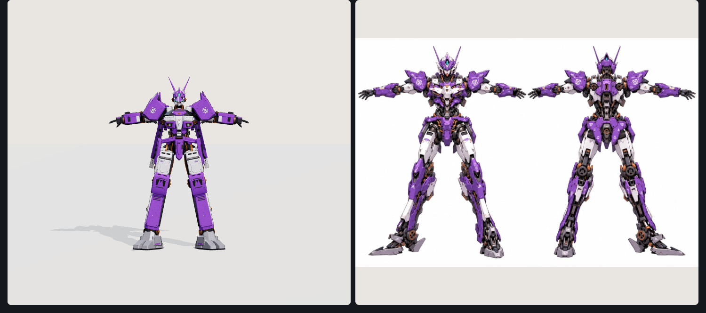
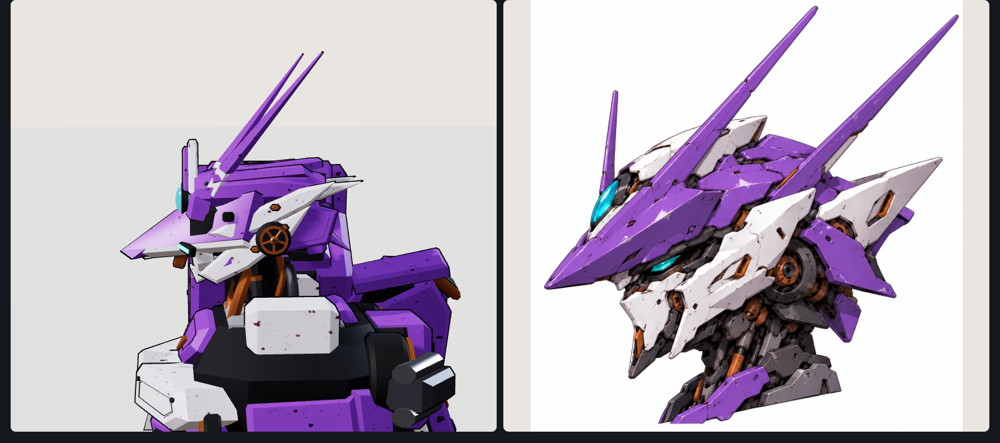
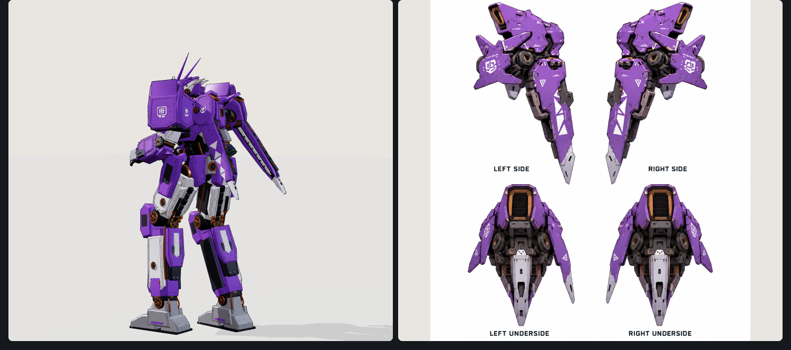

# AM-05 Amethyst — VECTORCLAD player frame

A purple and white frame with copper fittings and cyan lights. Its armor is a Blender model
(`am05.glb`, built by `tools/amethyst/build_am05.py`), hung on the stock rig so the stock animation
drives it. References:

- `reference-body.webp`: front and back sheet in a Vitruvian stance, for proportions, colors and parts.
- `reference-head.webp`: the helm in profile.
- `reference-pylon.webp`: the back pylon, made slimmer and longer here.
- The legs follow the user's blocky Bellerophon / BattleTech leg sheets, and the arms follow their arm
  sheet, all in the Amethyst's colors.

## Proportions

Measured off the body sheet, scaled so its chest matches the stock frame's:

| | Vanguard | Amethyst |
|---|---|---|
| Hip drop | 0.22 | 0.45 |
| Thigh | 1.8 | 2.2 |
| Shin | 2.6 | 3.5 |
| Ankle to sole | 0.55 | 1.2 |
| Pelvis height, walking | 4.3 | 6.9 |
| Shoulder joint, out from the spine | 1.32 | 1.4 |
| Upper arm / forearm | 1.0 / 1.24 | 1.15 / 1.4 |

The whole frame is drawn at `AmethystMech.SIZE` (0.84). Its shoulders then stand 1.4 higher than the
Vanguard's, so `rise: 1.4` in `js/frames.js` hangs it that much lower under the drop ship.

## How it animates

`AmethystMech` subclasses `Mech` like the Obsidian and the Pontifex. It strips the stock armor, keeps
every joint, socket and thruster, and grafts each `AM05_<joint>` group of the GLB onto the matching rig
joint. GLB empties the rig doesn't have become new pivots: codpiece, rear plate, side skirts, pauldrons,
pylons and finger segments. On top of the stock `animate()` it:

- stands upright, taking most of the stock hunch out of the spine;
- turns the pauldrons, which sit on the chest, part of the way with the arms;
- swings the codpiece, rear plate and side skirts clear of the thighs;
- curls the five jointed fingers round a held weapon;
- hangs the two pylons from sprung pivots, with the Obsidian's swing. The pylons trail the chest's
  motion, overshoot when the mech stops, and slide up and out with their lower ends flared like air
  brakes while falling. One deliberate difference: here a forward dash swings the lower ends *back*.
  The Obsidian's code swings them forward, although its README says back.

The walking knees point almost straight ahead (`static KNEE_OUT = 0.1`). The stock frames keep
`Mech.KNEE_OUT = 0.55`; `js/mech.js` now reads that value from the class instead of a constant.

The thrusters keep their roles in the new armor:

- the mains in the gray housings low on the back;
- the verniers out of the copper-ringed back ports;
- the calf jets in the calf bay;
- the sole jets in the heels.

## Rebuilding the model

1. `python tools/amethyst/make_textures.py` paints `tools/amethyst/tex/paint.jpg` (the wear map the
   purple, white and gray multiply) and `decals.png` (emblem, triangles, stencils, the thigh label).
2. In Blender (the MCP, or `blender -b -P`), with `AM05_EXPORT=1` set, run
   `tools/amethyst/build_am05.py`. It builds every part in game coordinates and writes `am05.glb`.
   `AM05_PARTS` limits the build to some parts while iterating; `AM05_POSE=reference` previews the sheet's stance.

Keep `LEG`, `HIP_X` and the joint positions in `build_am05.py` in step with `amethyst-mech.js`.

GLB naming:

- `pl_*`: plates and shells, which get the game's ink outline;
- `dt_*`: small details merged per joint and material;
- `dc_*`: decals, alpha-tested in game.

About 52k triangles, 3.1 MB with both textures embedded.

## Files

- `amethyst-mech.js`: the frame (`AmethystMech`) and `loadAmethystDetail()`, which `js/main.js` awaits at boot.
- `am05.glb`: the armor.
- `preview.html`: open it from the server (`/assets/amethyst-frame/preview.html`) for the reference
  stance and every stock motion. Cameras include a head profile and the chase view, with the reference
  sheets alongside.
- `tools/tests/amethyst.js`: runs the frame in the game. It checks the GLB grafts on, the frame draws at
  0.84, the soles stay on the ground standing and walking, and the pylons swing. It also measures `rise`
  and takes hangar, walk and dash shots.
