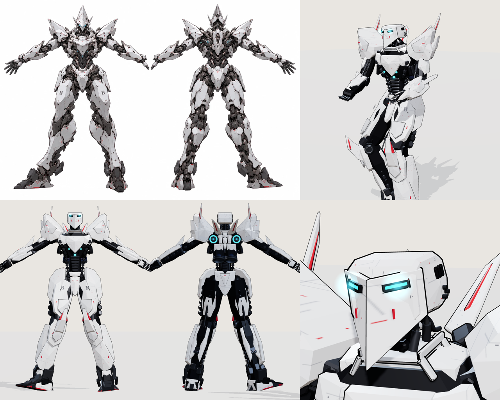

# PX-09 Pontifex — VECTORCLAD player frame

A three.js frame built from `reference.webp`, a front and back sheet of a white mech drawn in a
Vitruvian stance. It has white ceramic plates on a dark, segmented frame, a helm after the
"Assault" head concept (a rounded box housing, a bow-shaped front plate creased to a low point and an eye slit in each side), deep blade
pauldrons with fins and swept back wings like the Vanguard's, knee blades rising past the
knees, long "B"-marked thighs, flared shins and tall wedge
boots with red-tipped claws. The back carries two disc jets ringed in cyan.

## Proportions

The proportions were measured off the sheet. Scaled so its shoulders match the stock rig, the
sheet's torso and arms come out almost the same as the Vanguard's, and its legs much longer. The
torso and arms were then lengthened on request:

| | Vanguard | Pontifex |
|---|---|---|
| Thigh | 1.8 | 2.46 |
| Shin | 2.6 | 2.92 |
| Ankle to sole | 0.55 | 1.0 |
| Pelvis height, walking | 4.3 | 6.0 |
| Upper arm | 1.0 | 1.3 |
| Forearm | 1.24 | 1.38 |
| Waist to chest | 0.5 | 0.85 |

`js/mech.js` now reads leg lengths and gait from the class (`Mech.LEG`, `Mech.GAIT`), so a
subclass can set its own (`static LEG`, `static GAIT`). The Vanguard and Obsidian keep the
defaults and don't change.

## How it animates

`PontifexMech` subclasses `Mech` in the same way as the HV-02 Obsidian. It strips the stock armor,
keeps every joint, socket, thruster and hydraulic ram, and mounts new armor on the same joints. So
the stock `animate()` drives it unchanged: planted-foot gait, two-bone leg IK, aiming, recoil,
reload, shield guard, jumps and dashes. On top of that, it:

- takes most of the stock hunch out of the spine (the sheet stands upright), keeping the head and
  aim level, as the Citadel does;
- turns the pauldrons, which sit on the torso, with the arms by about a quarter;
- swings the long codpiece and the rear plate clear as the thighs move forward and back;
- curls the five-fingered hands round a held weapon, and relaxes them when the hand is empty.

The thrusters keep their roles, re-seated in the new armor: the mains in shrouded housings low on
the back, the verniers in the back discs, the calf jets between the calf leaves and the sole jets
in the heels. The frame stands 1.75 units taller at the shoulder than the Vanguard. `rise: 1.75`
in `js/frames.js` makes the Kestrel H's clamps hang it that much lower on the insertion.

`poseReference()` puts it in the sheet's stance for inspection only. The game never calls it.

## Files

- `pontifex-mech.js`: the frame (`PontifexMech`), with its own materials, a canvas plate texture
  (panel seams, red service marks) and the "B" stencil.
- `preview.html`: open it from the server (`/assets/pontifex-frame/preview.html`) to see the
  reference stance and every stock motion from any side, next to the Vanguard or beside the sheet.
- `reference.webp`: the source sheet.
- `tools/tests/pontifex.js`: renders the stance framed like the sheet, checks span and height
  against it, runs every motion, and plays the frame in the game.
